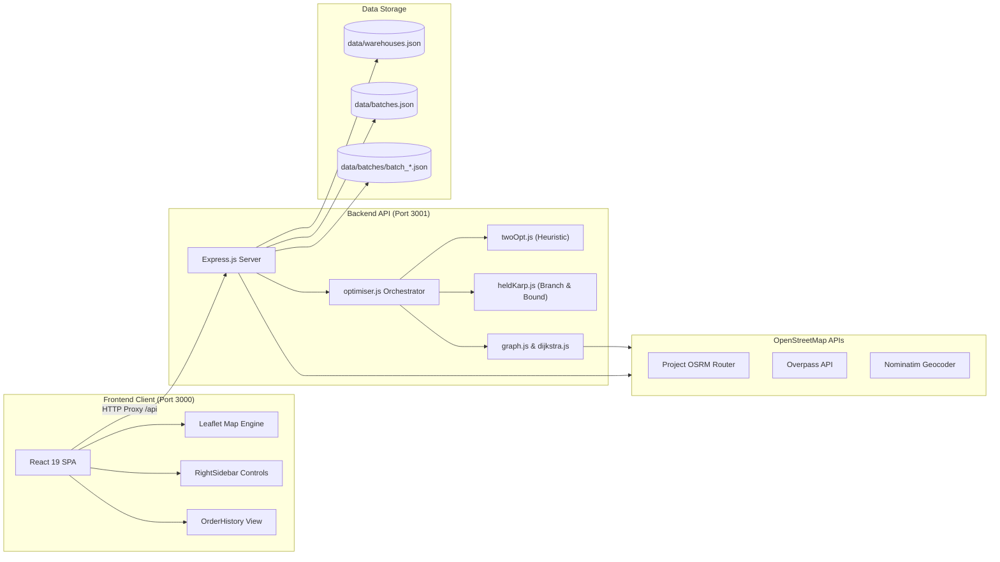

# 🚚 Intelligent Delivery and Route Optimization System (IDROS)

[](https://react.dev/)
[](https://expressjs.com/)
[](https://leafletjs.com/)
[](https://www.openstreetmap.org/)
[](https://vitejs.dev/)
[](#)
[](https://opensource.org/licenses/ISC)

> **A modern, intelligent delivery route optimization web application that maximizes delivery urgency and customer wait-time profit rather than just minimizing travel distance.**  
> Built with 100% open-source technologies (Leaflet & OpenStreetMap) — **zero Google Maps API keys or subscriptions required**.

---

## 📖 Table of Contents

- [🌟 What is IDROS?](#-what-is-idros)
- [🎯 The Problem It Solves](#-the-problem-it-solves)
- [✨ Key Features](#-key-features)
- [📐 The Core Innovation: Custom Profit Formula](#-the-core-innovation-custom-profit-formula)
- [🧠 How the Algorithms Work](#-how-the-algorithms-work)
- [🖥️ Step-by-Step User Guide](#️-step-by-step-user-guide)
- [🏗️ System Architecture & Tech Stack](#️-system-architecture--tech-stack)
- [⚡ Quick Start & Installation](#-quick-start--installation)
- [📡 API Reference](#-api-reference)
- [📁 Project Structure](#-project-structure)
- [💡 Common Questions (FAQ)](#-common-questions-faq)

---

## 🌟 What is IDROS?

Most traditional GPS and route planning tools (like the classic Traveling Salesperson Problem or Google Maps directions) optimize for **one thing only: the shortest distance** . 

However, real-world delivery logistics doesn't work that way:
- Delivering a critical medical package or an urgent hot meal **15 minutes earlier** is often far more valuable to a customer than saving 500 meters of fuel.
- Packages that have been waiting in the queue for a long time should be prioritized before newly placed orders.
- When a company operates **multiple warehouses** across a city, which warehouse should fulfill which batch of orders?

**IDROS solves these real-world challenges.** It is an interactive, full-stack web platform where dispatchers can place warehouse depots and delivery orders directly onto an interactive map. IDROS then evaluates all candidate warehouses, balances urgency and waiting times against road distances, and calculates the single highest-profit delivery route.

---

## 🎯 The Problem It Solves

| Traditional Route Optimizers ❌ | IDROS Route Optimizer ✅ |
| :--- | :--- |
| **Distance-Only**: Treats all packages identically, only minimizing total mileage. | **Urgency-Aware**: Prioritizes urgent items (e.g. medicine, VIP orders) earlier in the tour. |
| **Ignores Waiting Time**: Orders placed an hour ago get the same priority as orders placed 2 minutes ago. | **Wait-Time Boost**: Profit increases dynamically as customer waiting time accumulates. |
| **Single Manual Depot**: Requires the dispatcher to manually choose which warehouse delivers the batch. | **Dynamic Hub Selection**: Automatically tests all warehouses in the city to find the one with the highest overall delivery profit. |
| **Expensive Map APIs**: Requires commercial Google Maps or Mapbox API keys with monthly usage fees. | **100% Open Source**: Uses OpenStreetMap, Nominatim reverse geocoding, and Project OSRM driving servers. |
| **Messy Overlapping Batches**: Clutters the map when managing multiple consecutive delivery batches. | **Smart Route Layering**: Highlights the active batch in light blue with directional arrows, dimming past batches to dark blue. |

---

## ✨ Key Features

### 🗺️ 1. Interactive OpenStreetMap & Leaflet Canvas
- Smooth pan, zoom, and click-to-place interactions centered on Delhi, India (easily adaptable to any city).
- 100% open-source map tiles with automatic reverse geocoding to human-readable street addresses.

### 🏭 2. Multi-Storehouse Depot Management
- Add warehouse depots anywhere on the map with a single click.
- Depots are rendered as distinct **3D dark blue isometric cubes** with auto-incrementing identifiers (`Warehouse #1`, `Warehouse #2`).
- Depots can be toggled and deleted easily; all changes persist in local storage.

### 📦 3. Multi-Batch Delivery Workflow
- Queue up multiple consecutive batches with auto-incrementing batch IDs (`Batch #1`, `Batch #2`, etc.).
- Each order has an adjustable **Urgency Slider (1 to 99)** with color-coded map pins (green = low urgency, red = high urgency).
- **"Discard Batch"** button (with trash bin icon) to cancel drafts cleanly before placement.
- **"Add More Batches"** button (light green) below completed batches to keep delivery operations moving.
- Past batches collapse into compact summary badges showing:
  - `Batch #x`
  - `Orders: n`
  - `Round-trip distance: d km`

### 🎨 4. Dual-Color Route Visualization
- **Active / Expanded Batch**: Traced in vivid **light blue** (`#38BDF8`) with directional navigation arrows every 220 meters showing vehicle heading, and a dashed circular halo encircling the winning dispatch warehouse.
- **Other / Collapsed Batches**: Recede into the background in **dark blue** (`#1e3a8a`), keeping the map legible and clear.

### 🧠 5. Two-Tier Optimization Engine
- **2-Opt Local Search**: Quickly optimizes any batch size by swapping route segments to untangle loops and maximize profit.
- **Exact Search (Branch & Bound)**: Available for batches of up to 14 orders. Evaluates all permutation paths with mathematical upper-bound pruning to guarantee the absolute global maximum profit tour. Reuses the batch's frozen placement timestamp.

### 📜 6. Complete Order History & Safe Reordering
- Dedicated full-page **Order History tab** replacing the map for clean audit and reporting.
- Batches are ordered chronologically with live status badges (`processing...`, `Placed at: ...`, `Delivered at: ...`).
- Displays the exact algorithms used and an attractive mathematical formula card.
- **One-Click Reorder**: Click the dark blue arrow next to any past batch to instantly reload its orders into the active Orders tab.
- **Safety Validation**: If the original warehouse assigned to a past batch has since been deleted, IDROS halts the reorder and alerts the dispatcher with a clear warning banner.

---

## 📐 The Core Innovation: Custom Profit Formula

At the heart of IDROS is a custom mathematical objective function that replaces standard distance minimization. Every candidate delivery sequence is scored using this formula:

$$\text{Profit} = \sum_{k=1}^{n} \left[ \frac{\text{urgency}[k] + (\text{batch\_placement\_time} - \text{timestamp}[k])}{1 + \text{distance}[k]} \right] + \frac{1}{1 + \text{distance}[n+1]}$$

### What Each Part Means in Plain English:

```
                  [ Package Urgency ]  +  [ Customer Waiting Time in Mins ]
 Order Profit =  -----------------------------------------------------------
                              1  +  [ Road Distance Traveled so Far ]
```

1. **Numerator: $\text{urgency}[k] + (\text{batch\_placement\_time} - \text{timestamp}[k])$**
   - **Urgency (1–99)**: High-priority packages (e.g., medicine = 95) generate massive profit if delivered early. Low-priority packages (e.g., standard mail = 5) contribute less.
   - **Elapsed Waiting Time**: The difference between when the batch was dispatched and when the order was created. Orders that waited longer get an automatic priority boost.
2. **Denominator: $1 + \text{distance}[k]$**
   - $\text{distance}[k]$ is the cumulative road distance (in kilometers) from the warehouse through all stops up to stop $k$.
   - The further along the route an order is visited, the larger this denominator becomes, which **reduces the profit contribution**. This naturally incentivizes the solver to place urgent stops near the beginning of the trip.
   - The `+ 1` guarantees the denominator is never zero.
3. **The Final Comeback Term: $\frac{1}{1 + \text{distance}[n+1]}$**
   - Term $[n+1]$ represents the vehicle returning back to the warehouse depot after the final delivery.
   - Urgency is set to `1` and elapsed time is `0`.
   - This ensures the total round-trip distance is still penalized, discouraging absurdly long return journeys.

---

## 🧠 How the Algorithms Work

IDROS combines three algorithms working in harmony:

```
  [ OpenStreetMap Road Network ]
                 │
                 ▼
     1. Dijkstra's Algorithm
     (Finds true road distances between all points)
                 │
                 ▼
         2. 2-Opt Heuristic
     (Swaps route legs to maximize profit for any batch size)
                 │
                 ▼
  3. Exact Search (Branch & Bound)
     (Optional for ≤ 14 orders: finds the guaranteed global optimum)
```

### 1. Dijkstra's Algorithm (Road Routing)
- Standard straight-line (Euclidean) distance doesn't reflect one-way streets, rivers, or highway networks.
- IDROS fetches real street topologies using the OpenStreetMap Overpass API and Project OSRM.
- Dijkstra's algorithm searches the street junction graph to determine the true shortest driving path between warehouses and customer addresses.

### 2. 2-Opt Local Search (Fast Optimization)
- Starts with the initial order sequence.
- Evaluates route variations by picking two points, reversing the sub-segment in between, and recalculating the profit formula.
- If the new sequence produces higher profit, the change is accepted.
- Repeats iteratively (up to 500 iterations) until no further profit improvements can be found.

### 3. Exact Search with Branch & Bound (Global Guarantee)
- For batches with **14 orders or fewer**, dispatchers can click *"Optimise route"*.
- Explores all possible delivery permutations while computing a mathematical **upper bound** on remaining unvisited stops.
- If the best possible theoretical profit of an unexplored branch cannot beat the current best solution, the entire branch is pruned immediately.
- Reuses the saved `placedTimestamp` so that elapsed time calculations remain 100% fair and consistent.

---

## 🖥️ Step-by-Step User Guide

### 📍 Step 1: Add Storehouses (Depots)
1. Select **Storehouses** from the left navigation rail.
2. Click any location on the map. The street address is automatically reverse geocoded.
3. Click **Add warehouse to this location**. A 3D dark-blue warehouse marker (`Warehouse #1`) will appear on the map.
4. *(Optional)* Add multiple warehouses around the city — IDROS will automatically select the best one when orders are placed!

### 📦 Step 2: Create a Batch & Add Orders
1. Switch to **Orders** on the left rail. IDROS automatically opens `Batch #1`.
2. Click on the map where customers are located.
3. In the right sidebar:
   - Enter the **Product Name** (e.g. *"Emergency Medical Supplies"*).
   - Adjust the **Urgency Slider (1–99)**.
   - Click **Add Order**. An urgency-colored pin appears on the map with the stop number.
4. Add as many orders as needed for this delivery run.
5. If you made a mistake, click the red **Discard Batch** button (with trash bin) to reset the batch cleanly.

### 🚀 Step 3: Place Orders & Generate Optimal Route
1. Click the large blue **Place all orders (n)** button.
2. IDROS will:
   - Calculate road distances from every warehouse.
   - Run the 2-Opt profit maximization solver across all warehouses.
   - Highlight the winning warehouse with a glowing circle.
   - Render a continuous **light blue route line** with directional arrows.
   - Display driver statistics: total kilometers, 50 km/h average speed, and estimated return ETA.
3. Click on any stop in the sidebar or map pin to see its individual distance and delivery ETA.

### 🔬 Step 4: Fine-Tune with Exact Search (Optional)
- If your batch has 14 orders or fewer, click **Optimise route (no. of orders should be less than 15)**.
- IDROS executes the Branch & Bound search to test if an even higher profit route or alternative warehouse hub exists.
- The route and warehouse update dynamically with an informative confirmation banner.

### 🏁 Step 5: Finish Batch & Add More Batches
1. When delivery is completed, click **Finish Batch Delivery**.
2. To queue the next run, click the light green **Add more batches** button.
3. The previous batch neatly collapses into: `Batch #1 | Orders: 5 | Round-trip distance: 18.4 km`.
4. The map turns the finished batch's route to **dark blue**, and opens a fresh entry form for `Batch #2`.

### 📜 Step 6: Order History & 1-Click Reorder
1. Click **Order History** on the left rail. The map is replaced with a clean, full-width history audit log.
2. View batch status (`processing...`, `Placed at: ...`, `Delivered at: ...`), total distances, assigned depots, and the applied algorithm summary.
3. Click **Reorder** (dark blue right arrow):
   - IDROS verifies the assigned warehouse still exists in your active storehouses.
   - If valid, it redirects directly into the Orders tab with all orders pre-filled and ready to re-dispatch!

---

## 🏗️ System Architecture & Tech Stack



### Technology Breakdown

| Component | Technology | Version | Purpose |
| :--- | :--- | :--- | :--- |
| **Frontend Framework** | React | `^19.0.0` | Declarative UI, state management, hooks. |
| **Frontend Build Tool** | Vite | `^6.2.0` | Fast development server & optimized production bundler. |
| **Mapping Engine** | Leaflet | `^1.9.4` | Interactive tile maps, custom 3D markers, SVG pins, polylines. |
| **Icons** | React Icons (Feather) | `^5.2.0` | Modern, lightweight UI iconography. |
| **Backend Framework** | Express.js | `^4.21.2` | REST API routes, JSON parsing, middleware. |
| **HTTP Client** | Axios | `^1.7.2` | Server-to-server requests for geocoding and OSM graphs. |
| **Dev Orchestration** | Concurrently | `^8.2.2` | Launches client and server concurrently with one command. |
| **Data Persistence** | Structured JSON Files | Native ES | Human-readable, zero-configuration local database. |

---

## ⚡ Quick Start & Installation

### Prerequisites
Make sure you have **Node.js** (v18.0.0 or higher recommended) and **npm** installed on your computer.

```bash
node -v   # Should output v18.x, v20.x, or v22.x
npm -v
```

### 1. Clone or Open the Repository
```bash
cd intelligent-delivery-and-route-optimization-system
```

### 2. Install Dependencies
Run `npm install` in both the root and client folders:

```bash
# Install server & tool dependencies
npm install

# Install frontend dependencies
cd client
npm install
cd ..
```

### 3. Start the Development Server
Run the single start command from the project root:

```bash
npm run dev
```

This starts both services simultaneously:
- **Backend Server**: [http://localhost:3001](http://localhost:3001)
- **Frontend App**: [http://localhost:3000](http://localhost:3000)

Open **[http://localhost:3000](http://localhost:3000)** in your web browser to start using IDROS!

### 4. Build for Production
To create an optimized production build of the frontend:
```bash
npm run build
```
Compiled static assets will be output to `client/dist/`.

---

## 📡 API Reference

The Express server exposes the following clean RESTful API:

| Method | Endpoint | Description |
| :--- | :--- | :--- |
| `GET` | `/api/reverseGeocode?lat={lat}&lng={lng}` | Converts coordinates to a human-readable street address via Nominatim. |
| `GET` | `/api/warehouses` | Retrieves all saved warehouses. |
| `POST` | `/api/warehouses` | Adds a new warehouse depot `{ lat, lng, address, city }`. |
| `DELETE`| `/api/warehouses/:id` | Deletes a warehouse depot by ID. |
| `GET` | `/api/batches` | Returns all batches sorted chronologically (latest first). |
| `POST` | `/api/batches` | Creates a new draft batch `{ orders: [...] }`. |
| `PUT` | `/api/batches/:id` | Updates an existing draft batch. |
| `DELETE`| `/api/batches/:id` | Discards / deletes a batch and its saved JSON snapshot. |
| `POST` | `/api/batches/:id/place` | Solves 2-Opt route, assigns winning warehouse, and freezes placement time. |
| `POST` | `/api/batches/:id/optimiseHeldKarp` | Runs Exact Search (Branch & Bound) on batches with $\le 14$ orders. |
| `POST` | `/api/batches/:id/finish` | Marks a batch as delivered and records completion timestamp. |

---

## 📁 Project Structure

```
intelligent-delivery-and-route-optimization-system/
├── client/                               # Frontend React SPA
│   ├── src/
│   │   ├── components/
│   │   │   ├── LeftSidebar.jsx           # Navigation rail (Storehouses / Orders / History)
│   │   │   ├── MapView.jsx               # Leaflet map, 3D cubes, SVG pins, dual-color lines
│   │   │   ├── OrderHistory.jsx          # Historical audit logs & warehouse-checked reordering
│   │   │   └── RightSidebar.jsx          # Batch forms, urgency slider, stats, formula cards
│   │   ├── utils/
│   │   │   └── api.js                    # Frontend REST API client & browser OSRM leg router
│   │   ├── App.css                       # Global styles, 3D markers, animations, formula cards
│   │   ├── App.jsx                       # Root React state orchestrator & lifecycle manager
│   │   └── main.jsx                      # React 19 entry point
│   ├── index.html                        # HTML shell (Inter fonts, Leaflet CDN)
│   ├── package.json                      # Client dependencies & Vite scripts
│   └── vite.config.js                    # Vite config with port 3000 & /api proxy to 3001
├── data/                                 # Zero-configuration JSON persistence
│   ├── batches.json                      # Master index of all delivery batches
│   ├── warehouses.json                   # Saved warehouse depot records
│   └── batches/                          # Individual snapshot files (batch_<timestamp>.json)
├── server/                               # Backend Express Application
│   ├── batchStore.js                     # Multi-batch persistence & ID generator
│   ├── dijkstra.js                       # Dijkstra shortest path graph implementation
│   ├── graph.js                          # Haversine math, Overpass OSM query, OSRM routing
│   ├── heldKarp.js                       # Exact Search (Branch & Bound) solver (≤ 14 orders)
│   ├── index.js                          # Express server setup & REST endpoints
│   ├── optimiser.js                      # Optimization coordinator & ETA calculation
│   ├── orderStore.js                     # In-memory store (legacy compatibility)
│   ├── twoOpt.js                         # 2-Opt local search & Custom Profit Formula
│   └── warehouseStore.js                 # Warehouse persistence controller
├── package.json                          # Root scripts (npm run dev, concurrently, build)
└── README.md                             # Project documentation
```

---

## 💡 Common Questions (FAQ)

#### Q: Do I need a Google Maps API Key or a credit card?
**No.** IDROS was deliberately engineered to be 100% free and open-source. It uses OpenStreetMap tiles, Project OSRM driving servers, and OSM Nominatim reverse geocoding.

#### Q: Why does the route change when I increase the urgency slider?
Because IDROS maximizes the **Custom Profit Formula**. When you raise an order's urgency to 90+, the algorithm earns significantly more profit by visiting that stop earlier in the delivery sequence, even if it requires a slight road detour.

#### Q: Why is Exact Search disabled when I have 15 or more orders?
Finding the exact optimal sequence among $n$ orders is an NP-hard problem with $n!$ possible permutations. While 10 orders has $\approx 3.6$ million permutations, 15 orders has over **1.3 trillion permutations**. To prevent browser and server freezing, Exact Search is capped at 14 orders, while 2-Opt local search handles any larger batch size instantly.

#### Q: What happens if I try to reorder a batch whose warehouse was deleted?
IDROS checks your active warehouses before starting a reorder. If the assigned warehouse depot no longer exists, IDROS displays an alert banner explaining which warehouse is missing, preventing broken routes or orphaned orders.

---

## 📄 License

This project is open-source and released under the [ISC License](https://opensource.org/licenses/ISC). Feel free to use, modify, and extend it for academic, commercial, or personal logistics applications!

